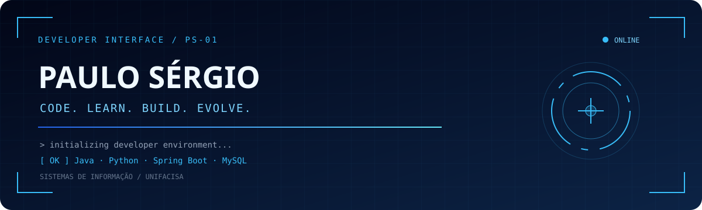

<div align="center">




</div>

---

## Sobre mim

Estudante de Sistemas de Informação, conectando o aprendizado acadêmico à prática em projetos.

```java
class PauloSergio {
    String nome = "Paulo Sérgio";
    String curso = "Sistemas de Informação";
    String instituicao = "Unifacisa";
    String cidade = "Riachão do Bacamarte / Campina Grande — PB";
    String foco = "Desenvolvimento de software";
    String objetivo = "Em busca de estágio em desenvolvimento de software";
}
```

## Tecnologias e ferramentas

<p align="center">
  
  
</p>

## Projetos em destaque

### [Projeto Impacta ↗](https://github.com/Paulo-SergioAlves/Projeto-Impacta)

Sistema para organizar ações socioambientais e voluntários, desenvolvido em equipe como projeto acadêmico.

**Java · Programação orientada a objetos · Testes unitários**

### [Sistema de Eventos ↗](https://github.com/Paulo-SergioAlves/sistema-eventos)

Projeto de gerenciamento de eventos que integra aplicações web, validação e persistência de dados.

**Java · Spring Boot · Spring Data JPA · MySQL**

## Aprendizado e próximos passos

```text
paulo@dev:~$ cat objetivos
> Aprofundar Java e programação orientada a objetos
> Construir aplicações com Spring Boot e MySQL
> Evoluir testes com JUnit e documentação dos projetos
```

## Minha atividade no GitHub

<p align="center">
  
  
</p>

<sub>As linguagens refletem o código dos repositórios analisados pelo serviço, não o nível de domínio de cada tecnologia.</sub>


<details>
<summary><strong>Ver mais estatísticas e conquistas</strong></summary>

<p align="center">
  
  <br /><br />
  
</p>

</details>

## Contribuições

<!-- Disponível após a primeira execução bem-sucedida de .github/workflows/snake.yml. -->
<picture>
  <source media="(prefers-color-scheme: dark)" srcset="https://raw.githubusercontent.com/Paulo-SergioAlves/Paulo-SergioAlves/output/github-contribution-grid-snake-dark.svg" />
  <source media="(prefers-color-scheme: light)" srcset="https://raw.githubusercontent.com/Paulo-SergioAlves/Paulo-SergioAlves/output/github-contribution-grid-snake.svg" />
  
</picture>

## Vamos conversar

Vamos trocar ideias sobre desenvolvimento, projetos e aprendizado.

<p align="center">
  <a href="https://www.linkedin.com/in/paulosergioalvespessoa/"></a>
  <a href="https://github.com/Paulo-SergioAlves?tab=repositories"></a>

  <a href="https://www.instagram.com/alvs.jr_/"></a>
  <a href="mailto:paulosergioalve.p.junior@gmail.com"></a>
</p>

<br />


